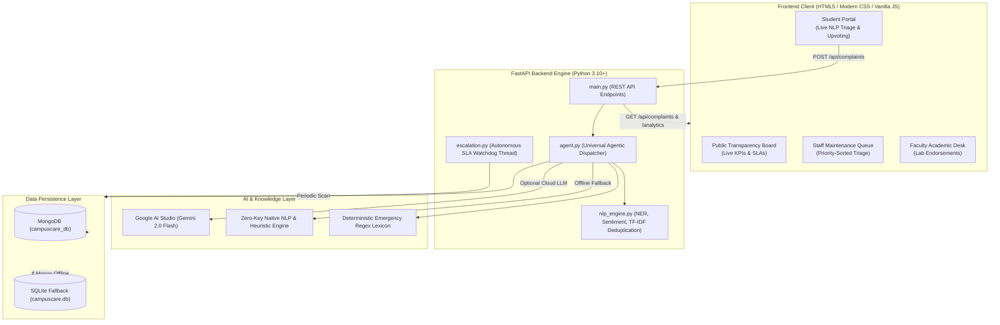

# 🎓 CampusCare AI — Autonomous Grievance & SLA Prioritization Engine

> **Agentic AI & NLP Campus Maintenance Intelligence Platform**  
> Built with **FastAPI**, **Google Gemini 2.0 / Native NLP Pipeline**, **MongoDB**, and modern **vanilla frontend**. Eliminates manual categorization dropdowns, clusters duplicate issues with semantic TF-IDF cosine distance, and enforces autonomous SLA escalation.

---

## 🌟 Key Highlights & Architectural Innovations

### 1. 🤖 Zero Manual Tagging (Autonomous NLP Entity Extraction)
- Students **never** have to pick from confusing category or affected radius dropdowns.
- The NLP engine scans natural language complaints in real-time, extracting:
  - **Physical Location & Room Numbers**: e.g. *"Room 302 Boys Hostel B"*, *"CS Lab 2, 2nd Floor"*.
  - **Campus Department Routing**: Electrical, Plumbing, IT & Network, Civil & Academic, Safety & Security.
  - **Emotional Distress & Urgency**: VADER sentiment and capitalized panic lexicons.

### 2. ⚡ Deterministic Emergency Safety Guardrails
- Instant pattern matching against multilingual safety hazards (`spark`, `burning smell`, `short circuit`, `gas leak`, `structural collapse`).
- Bypasses standard queues to auto-tag **🔴 Critical Hazard (< 4 Hours SLA)** with immediate dispatch to the **Rapid Hazard Response Unit**.

### 3. 👥 Semantic Vector Deduplication ("Affects Me Too" Anti-Spam Hub)
- Powered by **TF-IDF Vectorization & Cosine Similarity**.
- Prevents 50 students from filing 50 duplicate tickets for the same broken Wi-Fi router or water leak.
- Merges related complaints into trending outage clusters where students can click **👍 Affects Me Too** to boost priority.

### 4. ⏱️ Autonomous SLA Watchdog Agent
- Background daemon thread runs continuously.
- Dynamically checks ticket creation timestamps against due dates.
- Flags overdue tickets, turns countdown timers red, and initiates auto-escalation to senior administrative queues.

### 5. 🔐 Verified OTP Resolution Handshake
- Staff technicians cannot unilaterally mark an issue resolved.
- Closing a ticket requires entering a student OTP verification handshake code to prevent fake resolutions.

---

## 🏗️ System Architecture



---

## 🎨 Qualitative Priority Triage (Zero Arbitrary Points)

| Tier | Badge | Target SLA | Routing Unit |
| :--- | :--- | :--- | :--- |
| **Critical** | 🔴 Critical Hazard | `< 4 Hours` | Rapid Hazard Response Unit |
| **High** | 🟠 High Urgency | `< 24 Hours` | Specialist Utility Crew (Plumbing/Electrical) |
| **Medium** | 🔵 Medium Priority | `< 48 Hours` | IT Network / Facility Teams |
| **Low** | 🟢 Routine Maintenance | `< 72 Hours` | Routine Facilities Maintenance |

---

## 💻 Tech Stack

- **Backend**: Python 3.10+, FastAPI, Uvicorn, Pydantic v2.
- **AI & NLP**: Google GenAI SDK (Gemini 2.0 Flash Lite), Scikit-learn (TF-IDF Vectorizer & Cosine Similarity), VADER / Regex Tokenizers.
- **Database**: MongoDB (`pymongo`) with automatic SQLite fallback (`campuscare.db`).
- **Frontend**: Responsive Vanilla HTML5, CSS3 Variables, ES6 JavaScript (`Fetch API`, `LocalStorage` fallback).

---

## 🚀 Quickstart Guide

### 1. Clone the Repository
```bash
git clone https://github.com/your-username/campus-complaint-system.git
cd campus-complaint-system
```

### 2. Configure Environment Variables
Navigate into `backend/` and create your `.env` from the provided example:
```bash
cd backend
cp .env.example .env
```
Open `.env` and add your **Google Gemini API Key** (optional; works out of the box with zero-key native NLP!):
```env
GEMINI_API_KEY=your_key_here
GEMINI_MODEL=gemini-2.0-flash-lite
SLA_SCALE=0.01   # Rapid SLA for 5-minute live demo (set to 1.0 for production)
```

### 3. Install Python Dependencies
```bash
pip install -r requirements.txt
```

### 4. Start the FastAPI Server
```bash
uvicorn main:app --reload --port 8000
```
Backend will start on: `http://localhost:8000` (API Docs at `http://localhost:8000/docs`).

### 5. Launch the Web Frontend
Open `frontend/index.html` in your browser (or use VS Code Live Server):
```powershell
Start-Process msedge "frontend/index.html"
```

---

## 🧪 Demo Scenarios for Presentation

1. **Safety Hazard Auto-Detection**:
   - Title: `Dangerous sparking switchboard with water leak`
   - Description: `Room 302 Boys Hostel B has sparking wires next to a leaking pipe.`
   - *Result*: Instant auto-triage to **🔴 Critical Hazard (< 4h SLA)** without touching dropdowns.
2. **"Affects Me Too" Anti-Duplicate Cluster**:
   - In Student View, locate `Wi-Fi Access Point Down in Central Library` and click **👍 Affects Me Too**.
   - Notice the live counter boost without creating spam duplicates.
3. **Staff Dispatch & OTP Verification**:
   - Switch to **🛠️ Staff View**, click **"Assign"** to dispatch a technician, then click **"Resolve"** with OTP `5829` to demonstrate closed-loop validation.

---

## 🛡️ License
Distributed under the MIT License. See `LICENSE` for more information.
